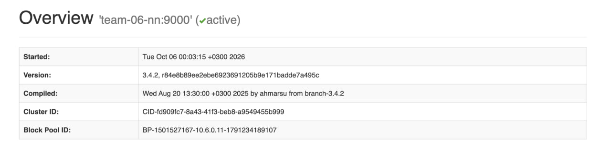
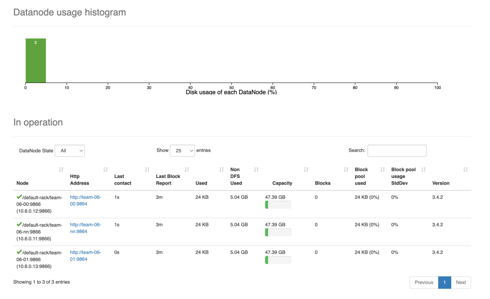

# ДЗ1. развёртывание HDFS

Скрипт hdfs_hw1_team06.sh автоматически разворачивает кластер HDFS: **NameNode**, **Secondary NameNode** и **3 DataNode**.


## Состав кластера

- Edge — `EDGE_IP` / `EDGE_HOST` → `10.6.0.10` / `team-06-en`
- NameNode, Secondary NameNode, DataNode — `NAMENODE_IP` / `NAMENODE_HOST` → `10.6.0.11` / `team-06-nn`
- DataNode — `DATANODE_0_IP` / `DATANODE_0_HOST` → `10.6.0.12` / `team-06-00`
- DataNode — `DATANODE_1_IP` / `DATANODE_1_HOST` → `10.6.0.13` / `team-06-01`

Третья DataNode работает на узле NameNode


**Для запуска на другой среде** замените в начале скрипта:
EDGE_IP, EDGE_HOST, NAMENODE_IP, NAMENODE_HOST,
DATANODE_0_IP, DATANODE_0_HOST, DATANODE_1_IP, DATANODE_1_HOST,
SSH_USER, SSH_KEY, DATA_DIR

## Требования

- Ubuntu 24.04 x86_64, systemd на всех узлах
- у `SSH_USER` — `sudo` без пароля; с edge SSH по ключу на три внутренних узла
- доступ к репозиториям Ubuntu и `archive.apache.org`
- чистый стенд: нет `/opt/hadoop*`, `$DATA_DIR`, unit `hdfs@.service`


## Запуск

С личного компьютера (подставьте путь к файлу и внешний адрес edge):

```bash
scp "/path/to/hdfs_hw1_team06.sh" team@<внешний-адрес-edge>:~/
ssh team@<внешний-адрес-edge>
```

На edge от `SSH_USER`, без sudo:

```bash
set -o pipefail
bash ~/hdfs_hw1_team06.sh 2>&1 | tee ~/hdfs-install.log
```

Скрипт запросит пароль пользователя `hadoop`: не короче 16 символов, хотя бы одна заглавная буква `A–Z`, одна строчная `a–z`, одна цифра `0–9` и один спецсимвол (не буква, не цифра и не пробел); повторный ввод должен совпасть с первым.

### Шаги, которые выполняет скрипт

1. Проверка ОС и отсутствия прежней установки на всех узлах
2. Установка Java 11 и Hadoop 3.4.2, пользователь `hadoop`, `/etc/hosts`
3. Минимальная конфигурация: `fs.defaultFS`, `hadoop.tmp.dir`, `dfs.replication=3`
4. Format NameNode, запуск NameNode → 3× DataNode → Secondary NameNode


## Проверка целостности

Интерфейс NameNode: `http://<NAMENODE_HOST>:9870` — 3 живых DataNode, без деградировавших.

Overview — NameNode active (`team-06-nn:9000`):



Datanodes — 3 узла In operation (`team-06-nn`, `team-06-00`, `team-06-01`):




