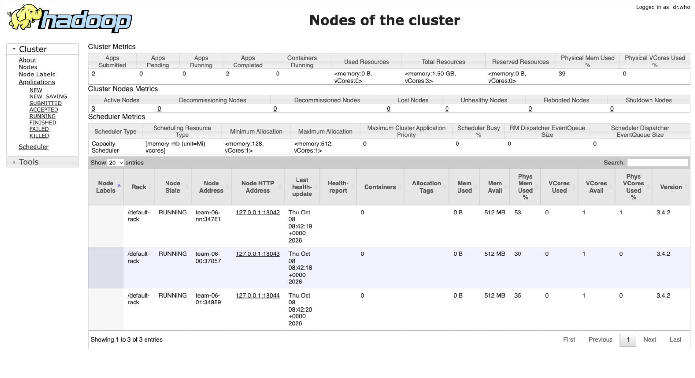
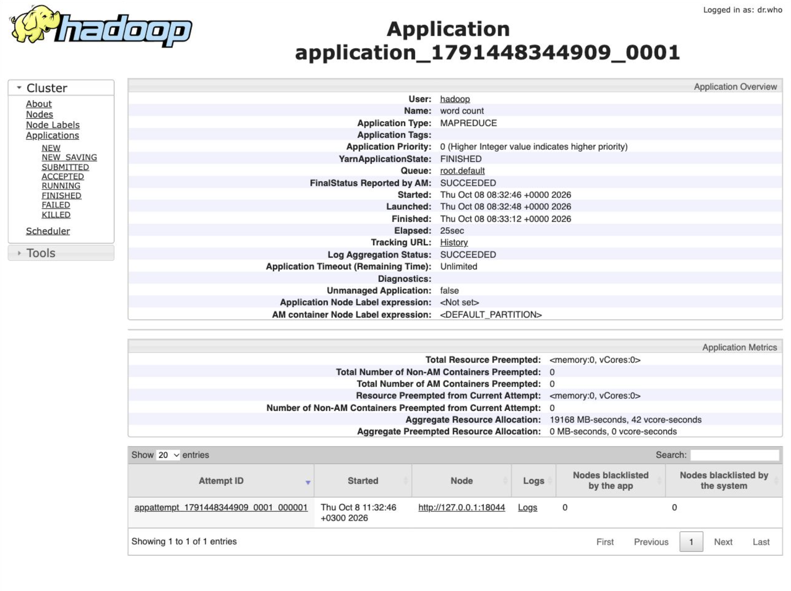
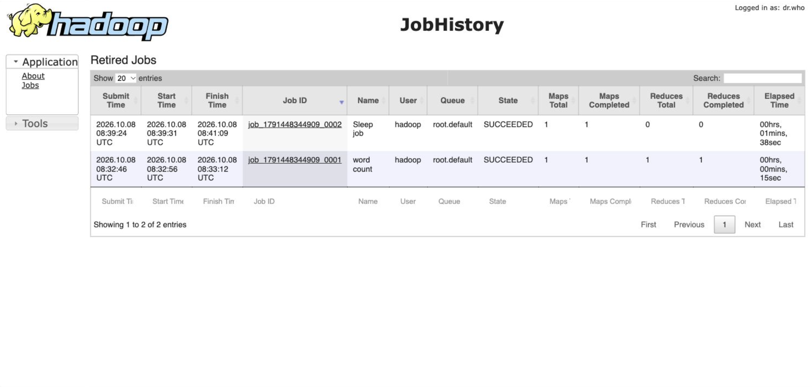

# Развёртывание YARN

Скрипт yarn_hw2_team06.sh автоматически разворачивает кластер YARN: ResourceManager, 3 NodeManager, JobHistory Server, Timeline Server и WebAppProxy.

## Состав кластера

- Edge, JobHistory Server, Timeline Server, WebAppProxy, nginx — `EDGE_IP` / `EDGE_HOST`: `10.6.0.10` / `team-06-en`
- ResourceManager, NodeManager — `NAMENODE_IP` / `NAMENODE_HOST`: `10.6.0.11` / `team-06-nn`
- NodeManager — `DATANODE_0_IP` / `DATANODE_0_HOST`: `10.6.0.12` / `team-06-00`
- NodeManager — `DATANODE_1_IP` / `DATANODE_1_HOST`: `10.6.0.13` / `team-06-01`

Для запуска на другой среде замените в начале скрипта:
EDGE_IP, EDGE_HOST, NAMENODE_IP, NAMENODE_HOST,
DATANODE_0_IP, DATANODE_0_HOST, DATANODE_1_IP, DATANODE_1_HOST,
SSH_USER, SSH_KEY, DATA_DIR

## Требования

- Ubuntu 24.04 x86_64, systemd на всех узлах
- у `SSH_USER` — `sudo` без пароля; с edge SSH по ключу на три внутренних узла
- установлены Java 11 и Hadoop 3.4.2 в `/opt/hadoop`, создан пользователь `hadoop`
- работают NameNode, Secondary NameNode и 3 DataNode; HDFS доступен с edge
- доступ к репозиториям Ubuntu

## Запуск

С личного компьютера (подставьте путь к файлу и внешний адрес edge):

```bash
scp "/path/to/yarn_hw2_team06.sh" team@<внешний-адрес-edge>:~/
ssh team@<внешний-адрес-edge>
```

На edge от `SSH_USER`:

```bash
set -o pipefail
bash ~/yarn_hw2_team06.sh 2>&1 | tee ~/yarn-install.log
```

При первом запуске скрипт запросит пароль для веб-интерфейсов. Логин — `team`. Сервисы Hadoop работают от пользователя `hadoop`.

### Шаги, которые выполняет скрипт

1. Проверка доступа к узлам, Java, Hadoop и готовности HDFS
2. Сохранение прежних настроек, установка конфигурации YARN и MapReduce на всех узлах
3. Создание каталогов HDFS, запуск ResourceManager, трёх NodeManager и вспомогательных сервисов: JobHistory Server, Timeline Server и WebAppProxy
4. Настройка nginx, проверка регистрации трёх NodeManager и результата WordCount

## Веб-интерфейсы

Доступ через localhost по SSH-туннелю. Прямой доступ к веб-портам по публичному IP на стенде недоступен и не требуется.

С личного компьютера, в отдельном терминале:

```bash
ssh -N -o ExitOnForwardFailure=yes -o ServerAliveInterval=30 \
  -L 127.0.0.1:9870:127.0.0.1:9870 \
  -L 127.0.0.1:9868:127.0.0.1:9868 \
  -L 127.0.0.1:19864:127.0.0.1:19864 \
  -L 127.0.0.1:19865:127.0.0.1:19865 \
  -L 127.0.0.1:19866:127.0.0.1:19866 \
  -L 127.0.0.1:8088:127.0.0.1:8088 \
  -L 127.0.0.1:18042:127.0.0.1:18042 \
  -L 127.0.0.1:18043:127.0.0.1:18043 \
  -L 127.0.0.1:18044:127.0.0.1:18044 \
  -L 127.0.0.1:19888:127.0.0.1:19888 \
  -L 127.0.0.1:8188:127.0.0.1:8188 \
  -L 127.0.0.1:9099:127.0.0.1:9099 \
  team@<внешний-адрес-edge>
```

Терминал оставить открытым на время просмотра. Если нужно указать ключ, добавьте `-i /path/to/key`. Туннель закрывается `Ctrl+C`.

| Интерфейс | Адрес |
|---|---|
| NameNode | `http://127.0.0.1:9870/` |
| Secondary NameNode | `http://127.0.0.1:9868/` |
| DataNode на NN, 00, 01 | `http://127.0.0.1:19864/`, `http://127.0.0.1:19865/`, `http://127.0.0.1:19866/` |
| ResourceManager | `http://127.0.0.1:8088/cluster` |
| NodeManager на NN, 00, 01 | `http://127.0.0.1:18042/node`, `http://127.0.0.1:18043/node`, `http://127.0.0.1:18044/node` |
| JobHistory Server | `http://127.0.0.1:19888/jobhistory` |
| Timeline Server | `http://127.0.0.1:8188/applicationhistory` |
| WebAppProxy | `http://127.0.0.1:9099/proxy/<application_id>/` — ссылка Tracking UI работающего задания |

## Проверка целостности

В ResourceManager, раздел Nodes: 3 узла в состоянии `RUNNING`, Lost Nodes и Unhealthy Nodes — 0.



В ResourceManager откройте WordCount из списка приложений. `FINISHED` означает, что задание завершилось, `SUCCEEDED` — что оно выполнено успешно.



JobHistory — завершённое задание со статусом `SUCCEEDED`:



WebAppProxy: ссылка Tracking UI работающего задания должна открывать страницу задания.
