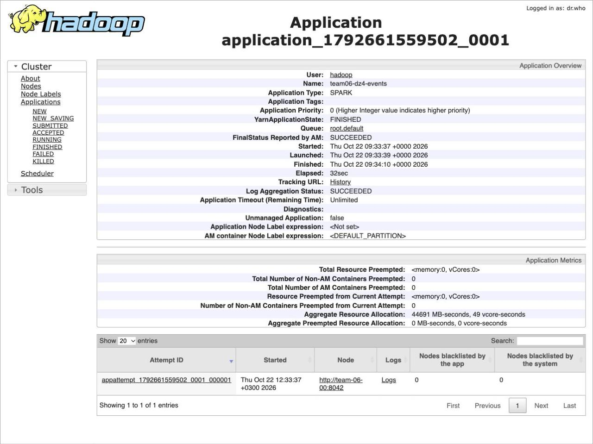
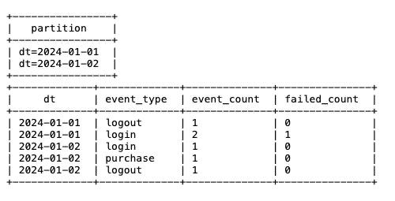

# Развёртывание Spark

Скрипт spark_hw4_team06.sh автоматически устанавливает Spark 3.5.9, обрабатывает данные из HDFS под управлением YARN и регистрирует результат в таблице Hive.

## Состав кластера

- Edge, драйвер Spark, HiveServer2, Hive Metastore — `EDGE_IP`: `10.6.0.10` / `team-06-en`
- ResourceManager, NodeManager, NameNode, DataNode — `NAMENODE_IP` / `NAMENODE_HOST`: `10.6.0.11` / `team-06-nn`
- NodeManager, DataNode — `DATANODE_0_IP`: `10.6.0.12` / `team-06-00`
- NodeManager, DataNode — `DATANODE_1_IP`: `10.6.0.13` / `team-06-01`

Для запуска на другой среде замените в начале скрипта:
EDGE_IP, NAMENODE_IP, NAMENODE_HOST, DATANODE_0_IP, DATANODE_1_IP,
SSH_USER, SSH_KEY, SOURCE_DIR, WAREHOUSE_TABLE_DIR, OUTPUT_DIR

## Требования

- Ubuntu 24.04 x86_64, systemd на всех узлах
- у `SSH_USER` — `sudo` без пароля; с edge SSH по ключу на три внутренних узла
- установлены Java 11, Hadoop 3.4.2 в `/opt/hadoop`, Hive 4.0.0-alpha-2 в `/opt/hive` и Python 3 на edge; создан пользователь `hadoop`
- работают HDFS и YARN; во время настройки в YARN нет выполняющихся заданий
- в HDFS загружены CSV с полями `id,event_type,status` за `2024-01-01` и `2024-01-02`: в `/input/events` или партициях `test.events`
- с edge доступен `archive.apache.org`

Выходной каталог `/user/hadoop/dz4/event_counts_by_day` и таблица `test.event_counts_by_day` создаются при запуске и не должны существовать заранее.

## Запуск

С личного компьютера (подставьте путь к файлу и внешний адрес edge):

```bash
scp "/path/to/spark_hw4_team06.sh" team@<внешний-адрес-edge>:~/
ssh team@<внешний-адрес-edge>
```

Если нужно указать ключ, добавьте `-i /path/to/key`.

На edge от `SSH_USER`:

```bash
set -o pipefail
bash ~/spark_hw4_team06.sh 2>&1 | tee ~/spark-install.log
```

Задание Spark и команды Hive выполняются от пользователя `hadoop`.

### Шаги, которые выполняет скрипт

1. Проверка готовности HDFS и исходных данных, установка Spark 3.5.9 с проверкой SHA512
2. Сохранение прежних настроек, увеличение лимитов памяти YARN с 512 до 1024 МБ, настройка Hive и перезапуск служб при необходимости
3. Обработка CSV через SparkSession: объединение данных, фильтрация строк без `id`, подсчёт событий по дате и типу, запись Parquet в HDFS с партиционированием по `dt`
4. Создание внешней таблицы `test.event_counts_by_day`, регистрация партиций и чтение результата через Beeline

`event_count` — число всех событий, `failed_count` — число событий со статусом `fail`.

## Веб-интерфейс

Доступ к ResourceManager через localhost по SSH-туннелю.

С личного компьютера, в отдельном терминале:

```bash
ssh -N -o ExitOnForwardFailure=yes -o ServerAliveInterval=30 \
  -L 127.0.0.1:8088:10.6.0.11:8088 \
  team@<внешний-адрес-edge>
```

ResourceManager: `http://127.0.0.1:8088/cluster`.

Терминал оставить открытым на время просмотра. Если нужно указать ключ, добавьте `-i /path/to/key`. Туннель закрывается `Ctrl+C`.

## Проверка целостности

В ResourceManager откройте `team06-dz4-events` из списка приложений. Тип приложения — `SPARK`. `FINISHED` означает, что задание завершилось, `SUCCEEDED` — что оно выполнено успешно.



В Beeline — две партиции: `dt=2024-01-01` и `dt=2024-01-02`. Запрос к `test.event_counts_by_day` возвращает пять строк.


